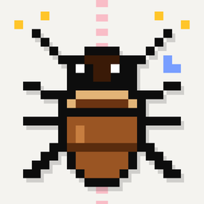
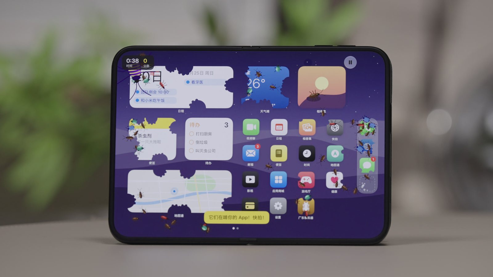
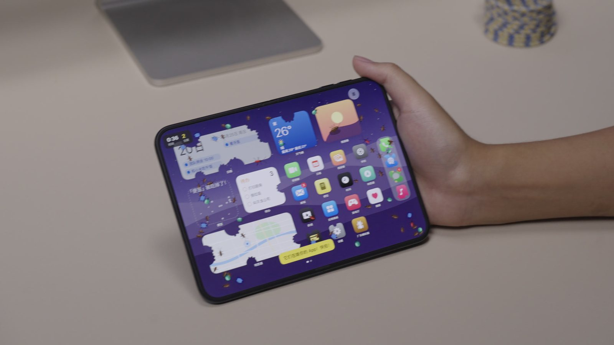

<p align="center">
  
</p>

<h1 align="center">光谱Spec · 广东模拟器</h1>

<p align="center">
  <b>Fold Smash</b> — 把 iPhone Duo 的铰链变成苍蝇拍：小强爬满屏幕，合上手机，一次全拍死。
</p>

<p align="center">
  
  
  
  
</p>

<p align="center">
  
  
</p>

> 这是光谱Spec 为 iPhone Duo 做的三个「最没用、但非常适合 iPhone Duo」的 App 之一，另外两个是
> [摸鱼浏览器](https://github.com/__OWNER__/GuangpuSpec-DecoyScreen) 和 [工位指示牌](https://github.com/__OWNER__/GuangpuSpec-DeskSign)。

## 玩法

- **展开手机**：小强从屏幕四边涌进来，围着食物啃。点一下能拍死一只，连续点出连击。
- **合上手机**：内屏上所有的小强一次拍死，伴随一声「啪！！」、震屏和触感反馈。合得越快倍率越高（慢合 ×1、利落 ×2、完美一拍 ×3）。
- **外屏来了一只**：手机合着时外屏会跑出一只很快的小强，点不中——得先打开手机把它困在折缝里，再「啪」地合上。
- **丢垃圾**：把食物丢进角落的垃圾桶当诱饵，等虫群聚过来再一次合上。食物被吃光就会丢分；垃圾放着不管还会孵出更多小强。（「手机屏幕」地图没有食物和垃圾桶，要保护的是图标。）
- 每局 60 秒，每张地图分别记录最高分。

### 6 张地图

| 地图 | 特点 |
| --- | --- |
| 厨房 | 瓷砖地面，标准难度 |
| 冰箱 | 冷藏室里的小强更慢 |
| 衣柜 | 木纹衣柜 |
| 办公桌 | 最快的一张 |
| 电脑屏幕 | 一个桌面窗口，最多约 110 只同时涌入 |
| 手机屏幕 | 仿 iPhone Duo 内屏桌面：左边组件、右边 App 网格、竖排 Dock，小强会把图标和组件一口口啃出缺口 |

### 5 种虫（菜单里有「蟑螂图鉴」）

| 虫 | 分数 | 特点 |
| --- | --- | --- |
| 小强 | 1 | 最常见的棕色蟑螂 |
| 翠甲虫 | 2 | 圆滚滚的绿色甲虫 |
| 红背飞毛腿 | 3 | 跑得飞快 |
| 蓝纹球潮虫 | 5 | 第一下只会缩成球 |
| 紫纹霸王 | 20 | 稀有 Boss，要点 3 下，或者一次合上 |

### 游戏之外：一只住在你手机里的小强

在「放出」页可以把小强放出去，让它在游戏外面也活着：

- **灵动岛**：它大多时间躲在岛里，会在随机、不可预测的时刻探出两根触角摸索几秒，再缩回去。没有文字，只有触角。
- **画中画**：一个悬浮小窗里的小强，窗口的暂停键就是苍蝇拍；点「回到 App」直接进游戏去追它。
- **桌面小组件「小强洞」**：在主屏幕放 1–4 号洞，小强会在洞之间搬家，偶尔探出头。
- **锁屏**：同一只小强，加一个拍打按钮。

> iOS 只允许 App 在运行时更新灵动岛，所以「探头」发生在：App 打开时、画中画让它保持后台时、离开 App 后约 30 秒内，以及系统给的后台刷新时机（大约每 15 分钟到几小时一次，由 iOS 决定）。

## 运行要求

- **Xcode 27.1**（iOS 27.1 SDK）：铰链 API 只在这个 SDK 里。
- **iPhone Duo** 真机，或在 Xcode 的 Device Hub 里可折叠的 iPhone Duo 模拟器。

## 开始使用

```bash
git clone https://github.com/__OWNER__/GuangpuSpec-FoldSmash.git
cd GuangpuSpec-FoldSmash
open CockroachSmasher.xcodeproj
```

1. 选择 scheme **CockroachSmasher 中文**，运行目标选 iPhone Duo（模拟器或真机）。
2. 真机运行前：在 **Signing & Capabilities** 里为 `CockroachSmasher` 和 `RoachWidgets` 两个 target 选择你自己的 Team，并把 Bundle Identifier（默认 `com.example.duovibes.cockroachsmasher`）和 App Group（`group.com.example.duovibes.foldsmash`）改成你自己的。
3. 按 ⌘R。没有真机也能玩：调试版里有一个「假铰链」滑杆，可以直接模拟合拢、帐篷、书本和展开。

> 用免费 Apple ID 签名时，App 7 天后会无法打开，重新连上电脑在 Xcode 里再运行一次即可。

## 项目结构

```
GuangpuSpec-FoldSmash/
├── CockroachSmasher.xcodeproj
├── CockroachSmasher/        App：游戏（GameModel、GameView）、地图与美术（Art、HomeScreenMap）、
│                             合成音效（SoundBoard）、灵动岛/画中画/小组件的调度（LifeDirector、RoachPiP）
├── RoachWidgets/            小组件扩展：灵动岛与锁屏实时活动、「小强洞」小组件
├── Shared/                  App 与扩展共用：五种虫的数据与绘制（BugArt）、小强的生活状态（RoachLife）
├── Config/                  Info.plist 与 entitlements（后台模式、App Group）
└── DuoKit/                  铰链层 Swift Package，见下文
```

所有虫子、地图和溅射效果都是用代码画的，音效也是实时合成的——仓库里没有图片或音频素材文件。

## DuoKit：铰链层

三个 App 共用的小型 Swift Package，把 iPhone Duo 的铰链 API 包成 SwiftUI 友好的接口：

```swift
@State private var monitor = HingeMonitor()

var body: some View {
    Content()
        .readsHinge(into: monitor)          // 在根视图附近调用一次
}

monitor.pose        // .closed / .tent / .book / .flat / .unknown
monitor.reading     // 角度（0 合拢，180 展平）+ 状态
monitor.velocity    // 每秒角度变化，合拢时为负——拍击倍率就来自它
monitor.onReading = { reading, velocity in … }   // 逐次采样回调，适合游戏
```

- 唯一直接调用 Apple 新 API 的文件是 `DuoKit/Sources/DuoKit/LiveHingeReader.swift`，SDK 有变化时只需改这里。
- 帐篷与书本都是 `partiallyOpen`，区别在于帐篷模式下系统把 App 放在外屏上，见 `PoseClassifier`。
- 测试：`cd DuoKit && swift test`。

## 已知限制

- 内屏上的分屏窗格同样是紧凑宽度，可能被误判为帐篷模式。
- 灵动岛和小组件的更新频率受 iOS 后台策略限制，见上文。

## English

**Fold Smash** turns the iPhone Duo's hinge into a fly swatter. Roaches swarm the inner screen; snap the phone shut to squash them all at once (the faster the snap, the bigger the multiplier). Six maps, including a recreation of the iPhone Duo Home Screen whose icons get chewed away, five species, and a roach that keeps living outside the game: in the Dynamic Island (only its antennae peek out), in a Picture-in-Picture window, in Home Screen widgets and on the Lock Screen. Requires Xcode 27.1 and an iPhone Duo or its simulator; set your own team, bundle ID and App Group before running on a device. Everything is drawn and synthesised in code.

## 许可

[MIT](LICENSE) © 2026 光谱Spec
